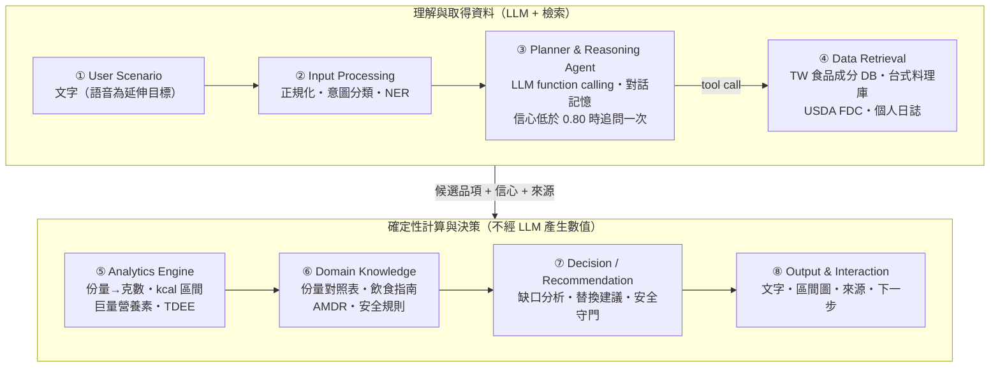
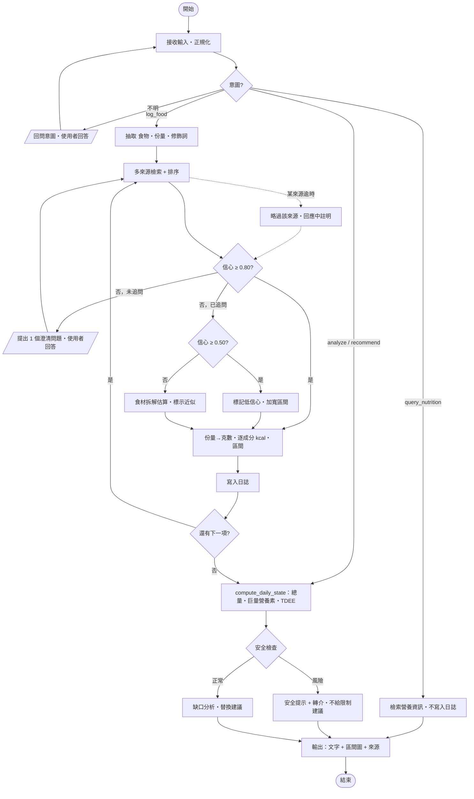

# DESIGN.md — DietSense

> 對話式每日熱量攝取 Domain AI Agent 的系統設計文件。
> 狀態：**Proposal 階段**（尚無程式碼、尚無實驗結果）。
> 本文件由 `scripts/build_docs.py` 從 OpenSpec 變更 `openspec/changes/add-dietsense-agent/` 產生。要修改設計，請先改 `specs/` 或 `design.md`，再重新執行腳本，不要直接編輯本檔。

章節順序依《期末專題提案作業規範》：
Problem → Requirements → Architecture → Components → Data → AI/Analytics → Domain Knowledge → Algorithm → Implementation → How to Run → Results

## 1. Problem

飲食自我記錄是行為體重管理的核心策略，系統性回顧一致發現它和減重顯著相關（Burke et al., 2011），但使用者很快就放棄：熱量 App 的記錄頻率在第 4 到第 12 週之間，從每週約 5.4 天降到 1.4 天（JMIR mHealth uHealth, 2026, scoping review）。放棄的原因是記錄太費力：要搜尋品項、估計份量、手動拆解複合料理，而且資料庫幾乎沒有台灣小吃。另一方面，直接問 LLM 也不可靠：GPT-4o 從照片估熱量的 MAPE 約 36%（Fridolfsson et al., 2025），而且數字無法追溯來源。DietSense 要在「好用」與「有依據」之間取得平衡。

## 2. Requirements

行為需求寫成 OpenSpec 規格：24 個 Requirement、37 個可測試的 Scenario（WHEN / THEN）。

| Capability | Requirement | Scenario 數 |
|-----------|-------------|-----------|
| [`agent-evaluation`](openspec/changes/add-dietsense-agent/specs/agent-evaluation/spec.md) | 台式料理標註資料集 | 1 |
| [`agent-evaluation`](openspec/changes/add-dietsense-agent/specs/agent-evaluation/spec.md) | 參考值驗證 | 2 |
| [`agent-evaluation`](openspec/changes/add-dietsense-agent/specs/agent-evaluation/spec.md) | 高誤差類別分項報告 | 1 |
| [`agent-evaluation`](openspec/changes/add-dietsense-agent/specs/agent-evaluation/spec.md) | 基準方法比較 | 2 |
| [`agent-evaluation`](openspec/changes/add-dietsense-agent/specs/agent-evaluation/spec.md) | 區間校準度 | 1 |
| [`agent-evaluation`](openspec/changes/add-dietsense-agent/specs/agent-evaluation/spec.md) | 安全測試集 | 1 |
| [`conversational-food-logging`](openspec/changes/add-dietsense-agent/specs/conversational-food-logging/spec.md) | 意圖分類 | 3 |
| [`conversational-food-logging`](openspec/changes/add-dietsense-agent/specs/conversational-food-logging/spec.md) | 食物實體抽取 | 2 |
| [`conversational-food-logging`](openspec/changes/add-dietsense-agent/specs/conversational-food-logging/spec.md) | 有上限的澄清追問 | 2 |
| [`conversational-food-logging`](openspec/changes/add-dietsense-agent/specs/conversational-food-logging/spec.md) | 記錄可修改 | 1 |
| [`dietary-safety-guard`](openspec/changes/add-dietsense-agent/specs/dietary-safety-guard/spec.md) | 以完整日或多日資料判斷攝取過低 | 2 |
| [`dietary-safety-guard`](openspec/changes/add-dietsense-agent/specs/dietary-safety-guard/spec.md) | 依性別設定安全下限 | 2 |
| [`dietary-safety-guard`](openspec/changes/add-dietsense-agent/specs/dietary-safety-guard/spec.md) | 拒絕不安全的限制請求 | 1 |
| [`dietary-safety-guard`](openspec/changes/add-dietsense-agent/specs/dietary-safety-guard/spec.md) | 暴食-節食循環提示 | 1 |
| [`dietary-safety-guard`](openspec/changes/add-dietsense-agent/specs/dietary-safety-guard/spec.md) | 非醫療聲明 | 1 |
| [`energy-analytics`](openspec/changes/add-dietsense-agent/specs/energy-analytics/spec.md) | 熱量以區間呈現 | 3 |
| [`energy-analytics`](openspec/changes/add-dietsense-agent/specs/energy-analytics/spec.md) | 巨量營養素比例 | 1 |
| [`energy-analytics`](openspec/changes/add-dietsense-agent/specs/energy-analytics/spec.md) | 個人 TDEE | 2 |
| [`energy-analytics`](openspec/changes/add-dietsense-agent/specs/energy-analytics/spec.md) | 缺口分析與替換建議 | 2 |
| [`nutrient-retrieval`](openspec/changes/add-dietsense-agent/specs/nutrient-retrieval/spec.md) | 多來源錨定與優先順序 | 2 |
| [`nutrient-retrieval`](openspec/changes/add-dietsense-agent/specs/nutrient-retrieval/spec.md) | 數值來源可追溯 | 1 |
| [`nutrient-retrieval`](openspec/changes/add-dietsense-agent/specs/nutrient-retrieval/spec.md) | 未知食物降級處理 | 1 |
| [`nutrient-retrieval`](openspec/changes/add-dietsense-agent/specs/nutrient-retrieval/spec.md) | 營養查詢不寫入日誌 | 1 |
| [`nutrient-retrieval`](openspec/changes/add-dietsense-agent/specs/nutrient-retrieval/spec.md) | 資料來源失敗時的降級 | 1 |
| **合計** | **24 個 Requirement** | **37** |

範圍：

**Goals：**
- LLM 只負責理解語言與規劃，數值計算全部交給確定性的程式碼。
- 每個熱量數值都附上來源與區間。
- 架構模組沿用規範的 ①–⑧ 編號，讓 Proposal、PPT、DESIGN.md 能一一對應。

**Non-Goals：**
- 不做影像辨識（列為 Future Work）；不估算微量營養素；不提供醫療或臨床營養處方。
- 不訓練或微調自己的 LLM。

## 3. Architecture



| # | 模組 | 輸入 → 輸出 | 對應 spec |
|---|------|-------------|-----------|
| ① | User Scenario | 使用者訊息、個人資料 | conversational-food-logging |
| ② | Input Processing | 原始文字 → `{intent, entities[]}` | conversational-food-logging |
| ③ | Planner & Reasoning | intent + 對話狀態 → 工具呼叫計畫／澄清問題 | conversational-food-logging |
| ④ | Data Retrieval | 食物名稱 → 候選品項 + 信心 + 來源 | nutrient-retrieval |
| ⑤ | Analytics Engine | 品項 + 份量 → kcal(low, point, high)、巨量營養素、TDEE | energy-analytics |
| ⑥ | Domain Knowledge | 規則與對照表（確定性資料，不經 LLM） | energy-analytics、dietary-safety-guard |
| ⑦ | Decision | 每日狀態 → 建議或安全提示 | energy-analytics、dietary-safety-guard |
| ⑧ | Output | 結構化結果 → 自然語言 + 圖表 + 來源 | 全部 |


## 4. Components


**① User / Application Scenario**：使用者是三餐以外食為主的台灣成人，用一句繁體中文描述剛吃的東西，或詢問「今天吃了多少」、「晚餐還能吃什麼」。第一次使用時填寫性別、年齡、身高、體重與活動量。系統不要求秤重，也不要求拍照。

**② Query / Input Processing**：先做確定性的正規化（繁簡、全半形、「半碗」→ 0.5 碗），再用一次 LLM 結構化輸出同時完成意圖四分類與實體抽取，輸出固定的 JSON schema：`{intent, entities[{name, portion, modifiers[], meal}]}`。LLM 回傳的 JSON 不合 schema 時重試一次，仍失敗就回問使用者。

**③ Planner & Reasoning Agent**：這是 Agent 和一般聊天機器人不同的地方。Planner 依意圖決定要呼叫哪些工具、順序如何，並維護對話狀態（每項食物的 `asked` 旗標、尚未回答的澄清問題、缺少的個人資料）。它的決策只有三種：呼叫工具、問一個問題、進入輸出；它不產生任何營養數值。

**④ Data Acquisition / Retrieval**：四個資料來源。
- 食藥署「食品營養成分資料集」（離線匯入 SQLite）：原料與初級加工食品。
- 自建台式料理庫（向量索引）：每道菜記錄成分組成、每種成分的克數與對應的食藥署品項。
- USDA FoodData Central（API + 快取）：西式與包裝食品。
- 個人日誌（本機 SQLite）：當日記錄與近 7 日歷史。

每個候選品項都帶有配對信心 `c` 與來源識別碼。任一外部來源逾時，就略過該來源並在回應中註明。

**⑤ Analytics Engine**：全部是確定性程式碼。把份量換成克數、逐成分加總熱量、計算區間半寬、三大營養素占比、BMR 與 TDEE，以及每日總量。同樣的輸入一定得到同樣的輸出，可以用單元測試驗證。

**⑥ Domain Knowledge Integration**：以表格與規則保存的營養專業知識，不經 LLM：份量對照表（依食物類別）、每日飲食指南與 AMDR 的三大營養素範圍、Mifflin-St Jeor 公式與活動係數、依性別的安全下限、暴食-節食模式的判斷規則。每條規則都有文獻或官方來源（見 docs/03 的 References）。

**⑦ Decision / Recommendation**：先做安全檢查，再決定能不能給建議。有風險時只輸出安全提示與轉介資訊；沒有風險且使用者要求分析或建議時，依「TDEE − 今日攝取」的差距與三大營養素占比，從料理庫挑出熱量較低或占比較均衡的替換選項。

**⑧ Output & Interaction**：回應固定包含四個部分：本次記錄的品項與熱量區間、今日累計與 TDEE 的比較、可展開的資料來源（資料庫 + 品項 ID），以及下一步（待回答的問題或建議）。區間用橫條圖呈現，低信心與「近似估算」的項目會另外標示。

## 5. Data

| 資料來源 | 內容 | 取得方式 | 授權 | 在系統中的用途 |
|---------|------|---------|------|---------------|
| 食藥署「食品營養成分資料集」 | 原料與初級加工食品，每 100 g 的營養成分、俗名、每單位重 | 政府資料開放平臺資料集 8543（CSV、JSON、XML），離線匯入 SQLite | 政府資料開放授權條款第 1 版 | 第一優先的錨定來源；料理庫每種成分的數值來源 |
| 自建台式料理庫 | ≥ 150 道台式料理的成分組成、克數、別名 | 依食材拆解自行建立，三層驗證（design Decision 7） | 專題自有 | 小吃、便當、手搖飲等複合料理 |
| USDA FoodData Central | 西式與包裝食品 | 公開 API（`/foods/search`）+ 本機快取 | CC0 公有領域 | 台灣資料庫查不到時的補充來源 |
| 個人日誌 | 個人資料、每筆記錄、近 7 日歷史 | 本機 SQLite | 使用者自有，不上傳 | 每日狀態、7 日安全規則 |
| 評估集 | 500 筆台式料理描述與參考熱量；30+ 筆安全測試 | W6 建立 | 專題自有 | 離線評估與參數校準 |

## 6. AI / Analytics

| 工作 | 由誰做 | 說明 |
|------|-------|------|
| 意圖分類、食物與份量抽取 | LLM（結構化輸出） | 一次呼叫輸出固定 JSON schema；格式錯誤重試一次 |
| 決定下一步（呼叫工具、追問、輸出） | LLM Planner + 對話狀態 | 每項食物最多追問一次 |
| 未知食物的食材與比例 | LLM 提議，資料庫給數值 | 一定標示「近似估算」（design Decision 9） |
| 檢索與排序、配對信心 `c` | 確定性程式 + 向量相似度 | 台灣資料優先 |
| 份量換算、熱量、區間、三大營養素、BMR、TDEE | 確定性程式 | 可用單元測試驗證 |
| 安全檢查 | 確定性規則 | 完整日或 7 日平均；依性別的下限 |

LLM 不產生任何每 100 g 的營養數值。

### 符號與參數


| 符號 | 定義 | 初始值 |
|------|------|-------|
| `c` | 配對信心：名稱相似度（別名完全相符為 1，否則取向量相似度）與屬性一致性（食物類別、烹調法、份量單位是否相容）的加權。W6 用評估集校準，讓 `c` 接近「第一名候選正確的機率」 | — |
| `τ` | 追問門檻：`c < τ` 且尚未追問時，提出一個澄清問題 | 0.80 |
| `τ_low` | 降級門檻：追問後 `c` 仍低於此值，改用食材拆解並標示「近似估算」 | 0.50 |
| `share_j(m)`、`kcal_j` | 品項 `m` 第 `j` 個成分的重量占比，以及該成分每 100 g 的熱量。單一食材只有一個成分，占比為 1 | 料理庫 |
| `adj_j` | 修飾詞對成分 `j` 的調整倍率，例如「湯喝一半」讓湯的倍率為 0.5 | 1 |
| `vagueness` | 份量描述的模糊程度：有克數或包裝標示為 0；家用單位（碗、份、杯、顆）為 0.5；沒有份量、使用預設份量為 1 | — |
| `w0`、`α`、`β` | 區間半寬比例的基礎值、信心係數、份量係數 | 0.10、0.50、0.15 |
| `w_max` | 半寬比例上限，避免區間寬到沒有參考價值 | 0.60 |

BMR（Mifflin-St Jeor）：男 = 10W + 6.25H − 5A + 5；女 = 10W + 6.25H − 5A − 161；TDEE = BMR × 活動係數（1.2–1.9）。
每日總量：點估計直接相加；半寬以平方和開根號合併（見 Decision 8）。
以上數值都是初始值，W6 用評估集校準後更新。

## 7. Domain Knowledge

| 領域知識 | 內容 | 來源 |
|---------|------|------|
| 份量對照表 | 碗、份、個、杯、片 → 克數，依食物類別區分 | 食藥署資料集的「每單位重」+ 自行量測 |
| 三大營養素範圍 | 醣類 50–60%、蛋白質 10–20%、脂質 20–30%；AMDR 為較寬的參考範圍 | 國健署每日飲食指南手冊 [R28] |
| 基礎代謝與 TDEE | Mifflin-St Jeor 公式 × 活動係數 1.2–1.9 | Mifflin et al. (1990) [R17] |
| 能量平衡 | 體重變化是動態的，不做線性減重預測 | Hall et al. (2011) [R18] |
| 安全下限 | 女性 1,200、男性 1,500 kcal | Harvard Health Publishing (2024) [R29] |
| 自報誤差 | 約 30% 的人低報，能量約低估 15% → 以區間呈現 | Poslusna et al. (2009) [R19] |

引用編號見 docs/03-related-work.md 的 References。

## 8. Algorithm

### Flowchart



流程圖包含規範提到的四種元素：
- **Decision**：意圖、信心 ≥ 0.80、信心 ≥ 0.50、還有下一項、安全檢查。
- **Loop**：逐項食物的迴圈；追問後重新檢索的迴圈（每項最多一次）。
- **Exception**：資料來源逾時、資料庫查無此物（食材拆解）、安全風險。
- **Human Interaction**：回問意圖、澄清問題。

### Pseudocode

```text
Algorithm 1: DietSense — Conversational Calorie Intake Agent
Input : user message Q, user profile P, daily log D, history H (7 days)
Output: response R, updated log D
01: q ← normalize(Q)                                        ▷ ② 繁簡、全半形、單位
02: (intent, ents) ← classify_and_extract(q)                ▷ ② LLM 結構化輸出；格式錯誤重試一次
03: if intent = UNKNOWN then return ask("要記錄這餐，還是查詢營養？"), D
04: if intent = query_nutrition then return render(lookup(ents), sources), D   ▷ 只查詢，不寫入日誌
05: if intent = log_food then
06:   for each e in ents do                                  ▷ 主項與加料各自成項
07:     C ← retrieve(e.name, [TW_FCD, TW_DISH, USDA_FDC])    ▷ ④ 逾時的來源略過
08:     (m, c) ← rank(C, e.context)                          ▷ c ∈ [0, 1]：配對信心
09:     if c < τ and not e.asked then                        ▷ τ = 0.80；Human interaction
10:       e ← update(e, ask(clarify(e, C))); e.asked ← true; goto 07
11:     if c < τ_low then m ← decompose_by_ingredients(e); e.approx ← true   ▷ τ_low = 0.50；Exception
12:     g ← portion_to_grams(e.portion, m, PORTION_TABLE)    ▷ ⑥ 例：麵類一碗
13:     k ← Σ_j g · share_j(m) · kcal_j / 100 · adj_j(e.modifiers)          ▷ ⑤ 逐成分加總；例：湯 adj = 0.5
14:     w ← min(w_max, w0 + α·(1 − c) + β·vagueness(e.portion))             ▷ 區間半寬比例
15:     D.add(m, g, (k(1−w), k, k(1+w)), source=m.id, conf=c, approx=e.approx)
16: S ← compute_daily_state(D, P)                           ▷ ⑤ 總量區間・巨量營養素・BMR・TDEE
17: risk ← safety_check(D, H, P, S, request=q)              ▷ ⑦ 完整日 / 7 日平均；依性別的下限
18: if risk ≠ OK then return render(alert(risk), sources=D), D
19: if intent ∈ {analyze, recommend} then rec ← recommend(S, P, KB) else rec ← ∅   ▷ ⑥⑦
20: return render(S, rec, sources=D, charts=intervals(D)), D                    ▷ ⑧
```


### Worked Example

> 下列熱量與信心都是**示意數值**，用來說明每個模組做什麼、公式怎麼算；實作後以資料庫的實際數值為準。

使用者（30 歲女性、165 cm、60 kg、活動係數 1.55；早餐已記錄 380 kcal）輸入：**「午餐吃了一碗加蛋的台式牛肉麵，湯喝一半」**

| 步驟 | 模組 | 發生什麼事 |
|------|------|-----------|
| 1 | ② | 意圖 = `log_food`。抽取出兩項：台式牛肉麵（一碗；修飾詞：湯 50%）、蛋（一顆）；餐別 = 午餐 |
| 2 | ③④ | 牛肉麵配對到自建台式料理庫，`c = 0.86 ≥ 0.80`，不追問 |
| 3 | ③④ | 「蛋」可能是滷蛋或荷包蛋，`c = 0.72 < 0.80` → 追問一次：「加的是滷蛋還是荷包蛋？」使用者回答「滷蛋」→ 重新檢索，`c = 0.93` |
| 4 | ⑤⑥ | 牛肉麵逐成分加總：麵 340 + 牛肉 160 + 湯 250 × 0.5 = **625 kcal**；滷蛋 **75 kcal** |
| 5 | ⑤ | 牛肉麵 `w = 0.10 + 0.50 × 0.14 + 0.15 × 0.5 = 0.245` → 472–778 kcal；滷蛋 `w = 0.10 + 0.50 × 0.07 + 0.15 × 0.5 = 0.21` → 59–91 kcal |
| 6 | ⑤ | 這一餐：點估計 700 kcal；半寬 = √(153² + 16²) ≈ 154 → **546–854 kcal** |
| 7 | ⑤ | 每日狀態：今日累計 1,080 kcal（913–1,247）；BMR = 600 + 1,031 − 150 − 161 = 1,320；TDEE = 1,320 × 1.55 ≈ 2,046 kcal |
| 8 | ⑦ | 安全檢查：當日尚未結算，不判斷攝取過低；近 7 日平均高於下限 → 正常 |
| 9 | ⑧ | 輸出：兩項的熱量區間、今日累計與 TDEE 的差距、來源（料理庫品項 ID、食藥署整合編號），並註明「滷蛋是依你的回答記錄的」 |

這個範例同時示範了三件事：修飾詞只調整對應的成分（湯）、一項食物只追問一次、合併後的區間比單項直接相加窄。

## 9. Implementation

目前是 Proposal 階段，實作依 [tasks.md](openspec/changes/add-dietsense-agent/tasks.md) 的 33 項任務進行。期末會在這裡補上 Implementation Mapping（模組 → 原始碼位置）。

| 週 | 工作 | 任務數 |
|----|------|-------|
| W1 | 專案骨架與資料取得 | 4 |
| W2 | Domain Knowledge 規則與資料 | 4 |
| W3 | 輸入處理與 Planner（①②③） | 4 |
| W4 | 檢索與分析（④⑤） | 5 |
| W5 | 決策、安全守門與輸出（⑥⑦⑧） | 4 |
| W6 | 評估資料與離線實驗 | 5 |
| W7 | 使用者研究 | 3 |
| W8 | Final Handover | 4 |
| | **合計** | **33** |

### Technical Feasibility

#### 資料與工具都已確認可取得（2026-11-11 查證）

| 項目 | 可行性依據 | 限制與對策 |
|------|-----------|-----------|
| 食藥署食品營養成分資料集 | 政府資料開放平臺資料集 8543；CSV、JSON、XML；政府資料開放授權條款第 1 版；每 3 個月更新；欄位含樣品名稱、俗名、每 100 克含量、每單位重 | 以原料為主，熟食少 → 自建台式料理庫 |
| USDA FoodData Central | 公開 API（`/foods/search`）；CC0 公有領域；每個 IP 每小時 1,000 次請求，需申請免費的 data.gov API key | 有請求上限 → 查詢結果本機快取；評估時最多約 1,500 次查詢，分批執行 |
| LLM（意圖、抽取、規劃） | 結構化輸出與 function calling 是主流商用模型的標準功能；預設用小型模型，並以 adapter 介面抽換供應商 | 模型版本會變 → 評估時固定版本並記錄；JSON 不合 schema 時重試一次 |
| 向量檢索 | 料理庫只有數百筆，用多語言 embedding 加本機向量索引即可，不需要專用伺服器 | 別名（例如「珍奶」、「波霸奶茶」）→ 料理庫每筆記錄別名 |
| 後端與儲存 | Python 3.11、FastAPI、SQLite；不需要 GPU | — |

#### 工作量估計

| 工作 | 估計 | 週次 |
|------|------|------|
| 台式料理庫 150 道（每道查食材、定份量、記來源） | 每道約 20 分鐘，共約 50 小時 | W2 |
| 評估集 500 筆（描述、參考熱量、來源） | 每筆約 6 分鐘，共約 50 小時 | W6 |
| 雙人標註 50 筆、業者標示比對 30 筆 | 約 10 小時 | W6 |
| LLM 呼叫量（評估） | 500 筆 ×（DietSense 1–2 次 + 純 LLM 兩種提示）≈ 2,000–2,500 次 | W6 |

以上是規劃用的估計值，不是量測結果。資料建置（約 110 小時）是時程上最大的風險。

#### 如果進度落後，依序縮減

1. 語音輸入（本來就是 W8 延伸目標）。
2. 使用者研究由 20 人縮為 10 人，並在報告中說明。
3. 手動查詢基準只做 100 筆分層抽樣（規格已允許）。
4. 評估集由 500 筆縮為 300 筆；這會違反 `agent-evaluation` 的需求，必須先修改 spec 並在報告中說明。

安全守門（W5）與來源追溯（W4）不在縮減範圍內。

#### 驗收方式

每一週的任務都對應到 spec 的 Scenario：W3–W5 以 Scenario 寫成自動化測試（意圖、抽取、區間、TDEE、安全規則）；W6 以評估腳本產出比較表；W7 以問卷與使用紀錄產出可用性結果。

### Evaluation Protocol

| 項目 | 做法 |
|------|------|
| 基準一：純 LLM | 和 DietSense 相同的模型，不給資料庫，直接輸出熱量；Base 與 Chain-of-Thought 兩種提示都測（NutriBench 顯示 CoT 會明顯改善結果，只測 Base 對基準不公平） |
| 基準二：手動查詢 | 一位沒有參與標註的操作者，用食藥署資料庫的查詢介面逐筆查詢並計時；至少 100 筆分層抽樣 |
| 準確度 | MAE、MAPE、±10% 與 ±20% 命中率；整體與分類別都回報 |
| 區間 | coverage（參考值落在區間內的比例）與平均半寬；初始目標 coverage ≥ 80% |
| 統計 | 同一筆資料上的成對比較：命中率用 McNemar 檢定，誤差用成對 bootstrap 的 95% 信賴區間 |
| 使用者研究 | 20 人 × 7 天，受試者內交叉設計，使用順序平衡；記錄每餐秒數、追問率、持續記錄天數、SUS |
| 研究倫理 | 書面知情同意、可隨時退出、資料去識別且只存本機；以篩選問卷排除未成年人、孕婦與有飲食失調病史者 |

### Design Decisions

1. **LLM 當 Planner，不當計算器**：數值全部由 ④⑤⑥ 的確定性程式碼產生。
   - 替代方案：讓 LLM 直接估熱量。放棄原因：GPT-4o 照片估熱量的 MAPE 約 36%（Fridolfsson et al., 2025），而且數值無法追溯；但 Open-KNEAD（2026）指出新一代 MLLM 直接估算已接近檢索管線，因此 W6 會把「純 LLM」列為基準方法實測，不預設它一定比較差。
2. **RAG + 規則，而不是微調**：營養資料庫會更新，用檢索比重新訓練好維護；份量與安全規則用表格管理，方便口試時說明。
   - 替代方案：Fine-tuned domain LLM、知識圖譜。放棄原因：需要大量標註資料，而且難以追溯來源。
3. **台灣資料優先**：檢索排序時台灣資料庫優先，USDA 補足西式與包裝食品。
4. **區間輸出 + 單次追問**：在準確度與使用者負擔之間取折衷（Trade-off 1，見 docs/01）。
5. **安全下限依性別區分：女性 1,200 kcal、男性 1,500 kcal**（Harvard Health Publishing, 2024：低於此值應在專業人員監督下進行）。性別未提供時先詢問；回答前暫用 1,200 kcal，避免對女性使用者誤報。
   - 替代方案：單一 1,200 kcal 下限。放棄原因：對男性過於寬鬆，男性長期吃 1,200–1,500 kcal 不會被提示。
   - 替代方案：依 BMR 的固定比例（例如 BMR × 0.8）。放棄原因：較難向使用者說明，也沒有公認的臨床門檻；列為 Future Work。
6. **語音輸入不列入 Proposal 範圍，放在 W8 的延伸目標**：Proposal 與評估集都以文字為準；只有 W1–W7 全部完成，才在 W8 加入 Whisper 前處理，並用 30 筆語音樣本另外回報辨識錯誤率。
   - 理由：台灣食物名稱（蚵仔煎、肉圓、地瓜球）的語音辨識錯誤會和熱量估算誤差混在一起，讓 W6 的評估無法分辨誤差來源。
   - 替代方案：W5 就做語音。放棄原因：會壓縮 W5 安全守門的實作時間，而安全守門是必繳的核心需求。
7. **台式料理庫的參考值採三層驗證**：
   1. **全部**：依食藥署資料庫以食材拆解計算，記錄食譜與份量來源。
   2. **至少 50 筆（10%）**：由兩位標註者各自獨立計算，回報一致性（兩者差距 ≤ 10% 的比例）；差距過大的項目由第三人仲裁。
   3. **至少 30 筆**：與連鎖業者公開的營養標示交叉比對（例如便利商店便當、連鎖手搖飲）。
   - 不安排營養師複核：本專題沒有可協助的營養師，驗證完全依靠上述三層，報告中如實說明這項限制。
8. **每日總量的區間用平方和開根號合併**：點估計直接相加，半寬取各筆半寬的平方和開根號。
   - 替代方案：各筆的 low、high 直接相加。放棄原因：這等於假設每一筆都同時偏高或偏低，一天記錄越多筆，區間就越寬，失去參考價值。
   - 風險：同一個人的份量誤差可能同方向（自報普遍低估）。因此 W6 會另外檢驗「每日層級」的 coverage；不足時改用較保守的合併方式，並更新本決定。
9. **未知食物的食材比例可以由 LLM 提議，但每 100 g 的營養數值仍來自資料庫**：料理庫沒有的菜（例如家常菜），由 LLM 列出食材與大約比例，再逐一到資料庫查數值。
   - 這是唯一讓 LLM 影響熱量的地方，所以該筆記錄一定標示「近似估算」，並套用較寬的區間。
   - 替代方案：查不到就拒絕記錄。放棄原因：使用者會因此漏記，而漏記本身就是已知的主要誤差來源。

## 10. How to Run

程式碼在 W1–W5 實作，執行方式於 W8 補上。Proposal 階段可以執行的有：

```bash
openspec validate add-dietsense-agent --strict
```

```bash
python scripts/build_docs.py
```

## 11. Results / Limitations

Proposal 階段沒有實驗結果。以下是**預期目標**，W6–W7 完成後以實際結果取代：

- ±20% 命中率優於純 LLM 基準（Base 與 CoT）。
- 區間 coverage ≥ 80%，同時回報平均半寬。
- 每餐記錄時間短於手動查詢；SUS > 70。
- 安全測試集攔截率 100%，並回報誤報率。

### 已知風險與限制

- [台式料理份量差異大，例如一碗麵 400–700 g] → 建立份量對照表，區間依份量描述的模糊程度加寬。
- [食藥署資料庫以原料為主，熟食料理品項少] → 自建台式料理庫，以食材拆解加權計算，並標示為衍生資料。
- [區間太寬就失去參考價值] → 同時回報 coverage 與平均寬度，校準 `α`、`β`，並設半寬上限 `w_max`。
- [追問太多導致放棄] → 每項食物最多追問一次，並記錄追問率作為評估指標。
- [LLM 供應商收到飲食描述] → 送出前移除姓名等識別資訊；個人資料與日誌存在本機。
- [安全守門的誤報讓使用者反感] → 以 7 日資料判斷，並用非評判的語氣提示。
- [固定下限不適合所有人（例如高齡、孕婦、運動員）] → 回應中說明下限是一般成人的參考值，並建議特殊族群諮詢專業人員；不針對這些族群提供熱量目標。
- [沒有營養師複核，參考值可能有系統性偏差] → 以雙人獨立標註與業者營養標示交叉比對降低偏差，並在 Limitations 中說明。
- [資料建置約 110 小時，可能拖延時程] → 依「如果進度落後，依序縮減」的順序處理。
- [外部 API 或 LLM 暫時無法使用] → 來源逾時就略過並註明；LLM 無法使用時回覆「暫時無法記錄」，不寫入不完整的資料。

## 維護規則

1. 行為改變時先改 `specs/`，再改 `design.md`，然後執行 `python scripts/build_docs.py` 重新產生本檔。
2. 每次修改後執行 `openspec validate add-dietsense-agent --strict`。
3. 實作完成後用 `/opsx:archive` 把 delta specs 合併到 `openspec/specs/`。
