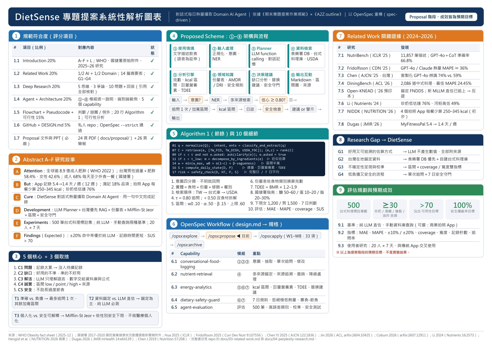

# DietSense — DIC3 Project Proposal Refactor using OpenSpec

**DietSense** 是一個對話式每日熱量攝取 Domain AI Agent：使用者用一句中文描述剛吃的東西，系統回覆有來源、有區間、有安全守門的熱量分析。LLM 只負責理解語言與規劃，營養數值全部來自資料庫與公式。

本 repository 用 OpenSpec（spec-driven development）重構期中 Proposal。目前是 **Proposal 階段**：沒有程式碼，也沒有實驗結果。



## 先看這三份

| 想看什麼 | 檔案 |
|---------|------|
| 完整的提案文件（Abstract → References，24 頁） | [docs/proposal/DietSense_Proposal.pdf](docs/proposal/DietSense_Proposal.pdf) |
| 系統設計（架構圖、流程圖、虛擬碼、可行性） | [DESIGN.md](DESIGN.md) |
| 簡報（26 頁） | [presentation/DietSense_Proposal_Refactored.pdf](presentation/DietSense_Proposal_Refactored.pdf) |

## 作業項目對照

| 作業要求 | 完成內容 | 檔案 |
|---------|---------|------|
| 1. install openspec and be familiar with spec-driven development | 已安裝 `@fission-ai/openspec` 1.17.0；`openspec init --tools claude --language zh-TW`；變更 `add-dietsense-agent` 的四份文件齊全並通過 `--strict` 驗證（見下方驗證紀錄） | [openspec/](openspec/)、[.claude/commands/opsx/](.claude/commands/opsx/) |
| 2. make clear of your project A to F：5 cores、3 trade-offs、10 details | 5 個核心、3 個取捨、10 個細節、A–F 對照表、約 500 字專業摘要 | [docs/01-abstract-A-F.md](docs/01-abstract-A-F.md) |
| 3. convert design.md to workflow in openspec | 期中稿第五節 → `proposal → specs → design → tasks`；24 個 Requirement、37 個可測試的 Scenario；W1–W8 共 33 項任務；DESIGN.md 由腳本從 OpenSpec 文件產生 | [openspec/changes/add-dietsense-agent/](openspec/changes/add-dietsense-agent/)、[DESIGN.md](DESIGN.md)、[scripts/build_docs.py](scripts/build_docs.py) |
| 4. Introduction refactor | A–F 重寫，所有數據改用可查證來源，補上 A2Z 的 L | [docs/02-introduction.md](docs/02-introduction.md) |
| 5. related work refactor | 1/2 AI + 1/2 Domain；14 篇文獻的 Article Summary Table（AI 8 篇、Domain 6 篇）；方法比較表；4 個 Research Gap；引用修正表 | [docs/03-related-work.md](docs/03-related-work.md) |
| 第一段 NotebookLM：依 A2Z 與規範解析 | 規範評分項目檢核、A2Z 26 字母對照、Deep Research 爭論證據更新 | [docs/05-notebooklm-analysis.md](docs/05-notebooklm-analysis.md) |
| 第一段 ChatGPT：A4 橫式高密度編號資訊圖表 | 9 個編號區塊的一頁圖表（HTML、PDF、PNG） | [docs/infographic/](docs/infographic/) |
| 第二段 Perplexity：最新研究、數據與案例 | Interesting／Innovation／Important 證據、預期貢獻與學術價值、A–F 補強建議 | [docs/04-perplexity-research.md](docs/04-perplexity-research.md) |
| 規範第三節 Deep Research（20%） | Q1 五個核心思維、Q2 三個爭論、Q3 十個問題＋回答；引用全部重新核對 | [docs/06-deep-research.md](docs/06-deep-research.md) |
| 規範必繳 Proposal Document | Abstract、Introduction、Related Work、Deep Research、Proposed Scheme、References 合成單一文件 | [docs/proposal/](docs/proposal/) |
| 規範必繳 Proposal PPT | 依重構內容重建的 26 頁簡報（PPTX、PDF、產生腳本） | [presentation/](presentation/) |

## 對照評分表

| 評分項目 | 比例 | 在哪裡 |
|---------|------|-------|
| Introduction：重要性、動機、Evidence、Innovation | 20% | [docs/02](docs/02-introduction.md)；Proposal 第 2 章 |
| Related Work：AI + Domain + Article Summary | 20% | [docs/03](docs/03-related-work.md)；Proposal 第 3 章 |
| Deep Research：5 Mindsets + 3 Controversies + 10 Questions | 20% | [docs/06](docs/06-deep-research.md)；Proposal 第 4 章 |
| Proposed AI Agent + System Architecture | 20% | [DESIGN.md § 3–4](DESIGN.md)：①–⑧ 架構圖、八個模組逐一說明、端到端範例 |
| Flowchart + Pseudocode + Technical Feasibility | 15% | [DESIGN.md § 8–9](DESIGN.md)：流程圖（Decision、Loop、Exception、Human Interaction）、20 行虛擬碼、可行性分析 |
| GitHub + DESIGN.md + 完整度 | 5% | 本 repository |

## OpenSpec workflow

```text
/opsx:explore  → 釐清想法（docs/01 的 5 核心 / 3 取捨）
/opsx:propose  → proposal.md + specs/ + design.md + tasks.md   ← 目前在這一步
/opsx:apply    → 依 tasks.md 實作（W1–W8）
/opsx:archive  → 實作完成後把 delta specs 合併到 openspec/specs/
```

常用指令：

```bash
openspec list
```

```bash
openspec status --change add-dietsense-agent
```

```bash
openspec validate add-dietsense-agent --strict
```

修改 `specs/` 或 `design.md` 之後，重新產生 DESIGN.md 與 Proposal 文件：

```bash
python scripts/build_docs.py
```

### 驗證紀錄（2026-11-11 實際輸出）

```text
$ openspec --version
1.17.0

$ openspec list
Changes:
  add-dietsense-agent     0/33 tasks

$ openspec status --change add-dietsense-agent
Change: add-dietsense-agent
Schema: spec-driven
Progress: 4/4 artifacts complete
[x] proposal
[x] specs
[x] design
[x] tasks
All planning artifacts complete!

$ openspec validate add-dietsense-agent --strict
Change 'add-dietsense-agent' is valid
```

## 5 個 capability

| Capability | 負責 | 架構模組 | Requirement／Scenario |
|-----------|------|---------|----------------------|
| `conversational-food-logging` | 意圖、食物抽取、單次追問、修改記錄 | ①②③ | 4／8 |
| `nutrient-retrieval` | 多來源錨定、來源追溯、營養查詢、未知食物與來源失敗時的降級 | ④ | 5／6 |
| `energy-analytics` | 熱量區間、巨量營養素、TDEE、缺口分析與替換建議 | ⑤⑥⑦ | 4／8 |
| `dietary-safety-guard` | 依性別的下限、7 日規則、拒絕極低熱量、暴食-節食提示 | ⑥⑦ | 5／7 |
| `agent-evaluation` | 500 筆標註集、參考值驗證、基準比較、區間校準、安全測試 | 評估 | 6／8 |

## 主要設計決定

| 問題 | 決定 | 理由 |
|------|------|------|
| 誰產生營養數值 | 資料庫與公式；LLM 只理解語言與規劃 | 數字可追溯；純 LLM 另列為必測基準 |
| 安全下限要不要依性別區分 | 要：女性 1,200、男性 1,500 kcal；未提供性別先詢問，回答前暫用 1,200 | Harvard Health（2024）的一般建議；單一 1,200 對男性太寬鬆 |
| 語音輸入放在哪一週 | 不列入 Proposal 範圍；W8 延伸目標，只在 W1–W7 完成時才做 | 避免語音辨識錯誤和熱量誤差混在一起；保住 W5 安全守門的時間 |
| 台式料理庫參考值怎麼驗證 | 三層驗證：食材拆解、≥ 50 筆雙人標註、≥ 30 筆業者標示比對；不安排營養師複核 | 沒有可協助的營養師；限制會在報告中說明 |
| 每日總量的區間怎麼合併 | 半寬取平方和開根號 | 直接相加會讓區間隨記錄筆數變得過寬；W6 檢驗每日層級的 coverage |
| 資料庫查不到的食物 | LLM 提議食材與比例，數值仍查資料庫，並標示「近似估算」 | 拒絕記錄會造成漏記 |

九個決定與被放棄的替代方案見 [design.md § Decisions](openspec/changes/add-dietsense-agent/design.md)。

## 關於 Perplexity、NotebookLM、ChatGPT 步驟

這三個步驟的產出都由 Claude 用網路搜尋與本機工具完成，**沒有實際使用這三個服務**；各文件開頭都有註明。所有引用都回到原始來源（期刊、PubMed、Crossref、arXiv、官方網站）確認。

## 第二輪複查（2026-11-11）改了什麼

- **補上評分表要求但原本沒有的內容**：Technical Feasibility（資料來源查證、工作量估計、縮減順序）、八個模組逐一說明、端到端範例、Evaluation Protocol。
- **流程圖與虛擬碼**：加入 `query_nutrition` 分支、逐項迴圈、未知食物與來源逾時兩個例外；虛擬碼由 18 行改為 20 行，並新增符號與參數表。
- **架構圖**：原圖的連線標籤含有 `<`，Mermaid 會出現語法錯誤；改成上下兩排的版本。
- **規格**：新增營養查詢、來源失敗降級、缺口分析與替換建議三個需求；修正安全規格中兩處前後不一致的敘述。
- **引用更正**：NutriBench 的份量結論原本引自二手摘要，回原文後改寫；Article Summary Table 由 9 篇擴充為 14 篇；R28 補上國健署手冊網址；N6 補上完整書目。
- **新增**：單一份 Proposal 文件（PDF）；DESIGN.md 改為完整文件，由腳本從 OpenSpec 產生。

## 待補事項

- N2（NUTRITION 2026）是研討會摘要，尚未經完整同儕審查；正式論文發表後再更新。
- 簡報用 `presentation/build-deck.js` 產生（pptxgenjs），想改內容可以直接改腳本重建，或在 PowerPoint 裡編輯。
- Proposal PDF 由 `docs/proposal/DietSense_Proposal.html` 用瀏覽器列印產生（需要網路載入 Mermaid）。
