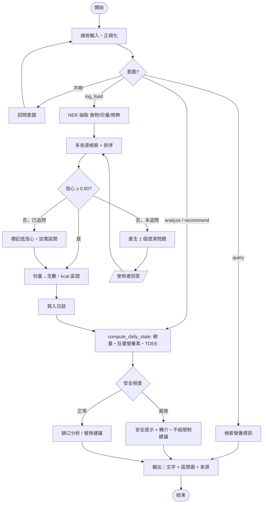

## Context

動機與範圍見 `proposal.md`；行為契約見 `specs/`。本文件由期中 Proposal 第五節（System Architecture、Flowchart、Pseudocode）重構而來，並修正原稿的三個設計問題：

1. **安全檢查會誤判**：原稿 `safety_check` 用「當日累計 < 1,200 kcal」判斷，吃完早餐就會觸發 DANGER。現在改成以完整日或 7 日平均判斷（見 `specs/dietary-safety-guard`）。
2. **`recommend` 分支用到未定義的變數**：原稿的 `tdee`、`macro_ratio` 只在 `analyze` 分支計算。現在改成共用的 `compute_daily_state()`，每個分支都可以使用。
3. **澄清迴圈沒有上限**：原稿只追問一次，但沒有定義回答後仍不足時怎麼辦。現在改成「最多追問一次，之後加寬區間」。

限制：Proposal 階段，還沒有程式碼；使用者是台灣成人；只支援文字（語音透過 Whisper 轉成文字）；個人資料存在本機。

## Goals / Non-Goals

**Goals：**
- LLM 只負責理解語言與規劃，數值計算全部交給確定性的程式碼。
- 每個熱量數值都附上來源與區間。
- 架構模組沿用規範的 ①–⑧ 編號，讓 Proposal、PPT、DESIGN.md 能一一對應。

**Non-Goals：**
- 不做影像辨識（列為 Future Work）；不估算微量營養素；不提供醫療或臨床營養處方。
- 不訓練或微調自己的 LLM。

## System Architecture（①–⑧）

```mermaid
flowchart LR
  U["① User Scenario<br/>文字 / 語音"] --> I["② Input Processing<br/>正規化・意圖分類・NER"]
  I --> P["③ Planner & Reasoning Agent<br/>LLM function calling・對話記憶"]
  P -->|tool call| R["④ Data Retrieval<br/>TW 食品成分 DB・台式料理向量庫・USDA FDC・個人日誌"]
  R --> A["⑤ Analytics Engine<br/>份量→克數・kcal 區間・巨量營養素・TDEE"]
  A --> K["⑥ Domain Knowledge<br/>份量對照表・AMDR / DRI・飲食指南・安全規則"]
  K --> D["⑦ Decision / Recommendation<br/>缺口分析・替換建議・安全守門"]
  D --> O["⑧ Output & Interaction<br/>Markdown・區間視覺化・來源・下一步"]
  P -. 信心 < 0.80 .-> U
```

| # | 模組 | 輸入 → 輸出 | 對應 spec |
|---|------|-------------|-----------|
| ① | User Scenario | 使用者訊息、個人資料 | conversational-food-logging |
| ② | Input Processing | 原始文字 → `{intent, entities[]}` | conversational-food-logging |
| ③ | Planner & Reasoning | intent + 對話狀態 → 工具呼叫計畫／澄清問題 | conversational-food-logging |
| ④ | Data Retrieval | 食物名稱 → 候選品項 + 信心 + 來源 | nutrient-retrieval |
| ⑤ | Analytics Engine | 品項 + 份量 → kcal(low, point, high)、巨量營養素、TDEE | energy-analytics |
| ⑥ | Domain Knowledge | 規則與對照表（確定性資料，不經 LLM） | energy-analytics、dietary-safety-guard |
| ⑦ | Decision | 每日狀態 → 建議或安全提示 | dietary-safety-guard |
| ⑧ | Output | 結構化結果 → 自然語言 + 圖表 + 來源 | 全部 |

## Flowchart



## Pseudocode

```text
Algorithm 1: DietSense — Conversational Calorie Intake Agent
Input : user message Q, user profile P, daily log D, history H (7 days)
Output: response R, updated log D'
01: q ← normalize(Q)                               ▷ 繁簡、全半形、單位
02: intent, ents ← classify_and_extract(q)         ▷ ②
03: if intent = UNKNOWN then return ask("要記錄還是查詢？")
04: if intent = log_food then
05:   for each e in ents do
06:     C ← retrieve(e.name, sources=[TW_FCD, TW_DISH_VEC, USDA_FDC])   ▷ ④
07:     (m, c) ← rank(C, e.context)
08:     if c < τ and not e.asked then                 ▷ τ = 0.80
09:       e ← update(e, ask(clarify(e, C))); e.asked ← true; goto 06
10:     g ← portion_to_grams(e.portion, m, PORTION_TABLE)              ▷ ⑥
11:     k ← g · m.kcal_per_100g / 100
12:     w ← w0 + α·(1 − c) + β·portion_vagueness(e)                    ▷ 區間半寬比例
13:     D.add(m, g, (k(1−w), k, k(1+w)), source=m.id, conf=c)
14: S ← compute_daily_state(D, P)                  ▷ ⑤ 總量區間・巨量營養素・BMR・TDEE
15: risk ← safety_check(D, H, P, S, request=q)     ▷ ⑦ 完整日 / 7 日平均規則
16: if risk ≠ OK then return render(alert(risk), sources=D)
17: if intent ∈ {analyze, recommend} then rec ← recommend(S, P, KB) else rec ← ∅
18: return render(S, rec, sources=D, charts=intervals(D)), D
```

參數：`w0 = 0.10`、`α = 0.50`、`β = 0.15`（初始值，W6 用評估集校準）。
BMR（Mifflin-St Jeor）：男 = 10W + 6.25H − 5A + 5；女 = 10W + 6.25H − 5A − 161；TDEE = BMR × 活動係數（1.2–1.9）。

## Decisions

1. **LLM 當 Planner，不當計算器**：數值全部由 ④⑤⑥ 的確定性程式碼產生。
   - 替代方案：讓 LLM 直接估熱量。放棄原因：GPT-4o 照片估熱量的 MAPE 約 36%（Fridolfsson et al., 2025），而且數值無法追溯；但 Open-KNEAD（2026）指出新一代 MLLM 直接估算已接近檢索管線，因此 W6 會把「純 LLM」列為基準方法實測，不預設它一定比較差。
2. **RAG + 規則，而不是微調**：營養資料庫會更新，用檢索比重新訓練好維護；份量與安全規則用表格管理，方便口試時說明。
   - 替代方案：Fine-tuned domain LLM、知識圖譜。放棄原因：需要大量標註資料，而且難以追溯來源。
3. **台灣資料優先**：檢索排序時台灣資料庫優先，USDA 補足西式與包裝食品。
4. **區間輸出 + 單次追問**：在準確度與使用者負擔之間取折衷（Trade-off 1，見 docs/01）。
5. **安全規則採用保守的固定下限（1,200 kcal）**：簡單、可以說明。之後可依性別、身體組成調整（列入 Open Questions）。

## Risks / Trade-offs

- [台式料理份量差異大，例如一碗麵 400–700 g] → 建立份量對照表，區間依份量描述的模糊程度加寬。
- [食藥署資料庫以原料為主，熟食料理品項少] → 自建台式料理庫，以食材拆解加權計算，並標示為衍生資料。
- [區間太寬就失去參考價值] → 同時回報 coverage 與平均寬度，校準 `α`、`β`。
- [追問太多導致放棄] → 每項食物最多追問一次，並記錄追問率作為評估指標。
- [LLM 供應商收到飲食描述] → 送出前移除姓名等識別資訊；個人資料與日誌存在本機。
- [安全守門的誤報讓使用者反感] → 以 7 日資料判斷，並用非評判的語氣提示。

## Migration Plan

新專案，不需要遷移。部署順序：本機 CLI → FastAPI + 簡易 Web Chat → 使用者研究版本。若要回復，只要切換 Git tag。

## Open Questions

- 安全下限要不要依性別區分（例如女 1,200、男 1,500）？不影響架構，只改規則表。
- 語音輸入要在 W5 做還是延到 Final？只影響 ② 的前處理。
- 台式料理庫的參考熱量，除了食材拆解，是否有營養師可以抽樣複核 50 筆？
