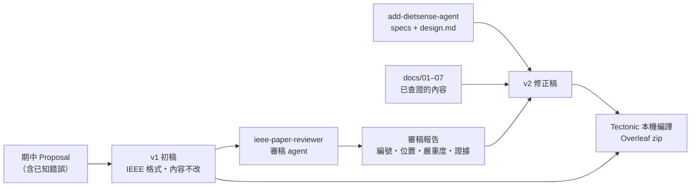

## Context

DIC4 要求：Overleaf 上的 IEEE 會議論文初稿，以及放在 GitHub 的 OpenSpec 結構。DietSense 的系統設計已經在 `add-dietsense-agent` 中完成並通過 `--strict` 驗證；這個變更只處理「把設計寫成論文」以及「找出並修正錯誤」兩件事。

## Goals / Non-Goals

**Goals：**
- 產出可直接上傳 Overleaf 的 IEEE 會議論文（v2），每個數字都有可查證的出處。
- 保留期中稿直接排版的初稿（v1），讓審稿前後的差異看得見。
- 審稿規則寫成可重複使用的 agent 定義，而不是一次性的人工檢查。

**Non-Goals：**
- 不新增實驗結果；論文只描述設計與評估計畫。
- 不改變 DietSense 的系統規格。

## Workflow

## Decisions

1. **v1 只翻譯與排版，不修正內容**：v1 的目的是讓錯誤被看見，所以期中稿的數字、引用與虛擬碼都原樣保留，只翻成英文並套上 IEEE 格式。
   - 替代方案：讓 AI 重新寫一版初稿再找錯。放棄原因：錯誤是當場產生的，不能代表專題原本的問題。
2. **v2 的內容來源是規格與已查證的 docs，而不是逐句修改 v1**：v1 的結構（例如條列式摘要、5 篇沒有作者的文獻表）本身就有問題，逐句修改會留下結構性的缺陷。
3. **審稿規則寫成 Claude Code 的 subagent**（`.claude/agents/ieee-paper-reviewer.md`）：之後的 Final Paper 可以重複使用同一份檢查清單。
4. **本機用 Tectonic 編譯驗證**：這台電腦沒有 TeX 發行版，Tectonic 是單一執行檔，會自動下載需要的套件；Overleaf 用 pdfLaTeX，兩者都使用 IEEEtran 與 BibTeX。
5. **圖用 TikZ 畫在 LaTeX 裡**：不依賴外部圖檔，上傳 Overleaf 時不會漏檔，也方便之後修改。

## Risks / Trade-offs

- [Tectonic 與 Overleaf 的 TeX 版本不同，可能一邊能編譯另一邊不行] → 只使用 IEEEtran、amsmath、algorithm、algpseudocode、tikz、booktabs 等常見套件。
- [6 頁限制讓 Deep Research 的內容放不下] → 論文只保留五個核心思維的設計影響，完整內容留在 docs/06。
- [審稿 agent 可能漏掉錯誤] → 報告和 docs/03 的引用修正表交叉比對。
